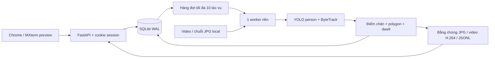

# Kiến trúc và phạm vi

> Sơ đồ và mô tả dưới đây là nền tảng v1. Bản mở rộng 16/10 bổ sung Pose, các quy tắc hành vi thử nghiệm, đông người/lưu trú lâu và model ONNX lửa/khói. Mặc định không làm mờ. Phạm vi và kết quả hiện hành nằm trong [VERIFICATION.md](VERIFICATION.md) và [EXPANSION_CONTRACT.md](EXPANSION_CONTRACT.md); kết nối camera vẫn được hoãn theo yêu cầu.

## API chính

Swagger local: `/docs`. Các API nguồn, tác vụ, cảnh báo, artifact đều cần cookie đăng nhập.

| Nhóm | Endpoint | Quyền |
|---|---|---|
| Auth | POST `/api/login`, `/api/logout`; GET `/api/me` | Đăng nhập / phiên hiện tại |
| Nguồn | GET `/api/sources`, `/{id}`, `/{id}/thumbnail` | Viewer trở lên |
| Upload | POST `/api/sources/upload` | Operator trở lên |
| Tác vụ | POST `/api/jobs`, POST `/{id}/cancel` | Operator trở lên |
| Kết quả | GET `/api/jobs`, `/{id}`, `/{id}/files/{name}` | Viewer trở lên |
| Cảnh báo | GET `/api/alerts`, `/{id}/evidence`; PATCH `/{id}` | Xem: viewer; duyệt: operator |
| Báo cáo | GET `/api/export/alerts.csv`, `/api/stats`, `/api/training` | Viewer trở lên |
| Quản trị | GET/POST `/api/users`, GET `/api/audit` | Admin |

## Quy tắc sự kiện

- Class duy nhất: `person`, không suy luận danh tính, tuổi hay mục đích.
- Chân = trung điểm cạnh dưới bounding box. Đa giác gồm tọa độ chuẩn hóa 0–1, biên được tính trong vùng; từ chối vùng tự cắt và diện tích bằng 0.
- Một track phải có ít nhất 3 quan sát và đủ thời gian dwell. Mất quan sát ngắn (tối đa 0.5s, tăng theo stride nếu cần) giữ visit; ra khỏi vùng khi được quan sát thì reset ngay. Khoảng mất ngắn được tính vào thời gian dwell giả định liên tục.
- Cảnh báo một lần cho mỗi `(zone index, track ID, visit)`. Vùng chồng nhau có cảnh báo riêng. ID đổi sau che khuất có thể tạo cảnh báo mới; không tuyên bố chống trùng theo danh tính người.
- `video_time` là frame index / FPS, không phải thời điểm thực tế được ghi hình. `created_at` là thời điểm server tạo sự kiện.
- `people` là đếm trong frame, `peak_people` là đỉnh trong clip. Không phải số người duy nhất.

## Hiệu năng và độ bền

- Một worker để tránh tranh chấp CPU và trạng thái tracker. Detector mới cho từng job để ID không bị lẫn video.
- H.264 được ghi qua FFmpeg pipe; không giữ cả video trong RAM. Detections được ghi JSONL tuần tự. Mỗi job có config và summary riêng.
- Tiến độ được lưu mỗi khoảng 0.5s; frontend polling 1s khi job chạy. Video hỗ trợ HTTP Range để tua trên Chrome.
- Cancellation được kiểm tra giữa các frame, không cưỡng bức ngắt inference giữa chừng. Tác vụ thất bại/hủy vẫn giữ bằng chứng đã có, không phát partial video như video hoàn tất.
- Upload định dạng video tối đa 1GB; file tạm hỏng bị loại bỏ. Nguồn được giới hạn trong dataset root hoặc uploads, không mở đường dẫn bất kỳ từ API.
- Password scrypt+salt, session token hash trong DB, cookie HttpOnly/SameSite, kiểm tra Origin và Host, phân quyền server-side, audit và giới hạn login. Local HTTP không có secure cookie; HTTPS/reverse proxy là việc cần làm nếu triển khai thật.

## Giới hạn đang công bố

Người bị che khuất, rất nhỏ hoặc sát mép ảnh còn có thể bị bỏ sót. Pixelation chỉ che vùng người đã phát hiện, không bảo đảm ẩn người bị model bỏ sót. Khi stride > 1, frame bỏ qua được blur toàn ảnh để tránh xuất frame đó không che; nên dùng stride=1.

Chưa triển khai RTSP/live, nhận diện khuôn mặt, nhận biết đánh nhau, đồ vật bỏ quên, phát hiện toàn bộ hành vi bất thường, push/email/SMS hoặc hệ thống camera nhiều máy. Không dùng mask anomaly ShanghaiTech để tuyên bố model đã biết các hành vi này.

Đây là bộ ứng dụng local hoàn chỉnh cho phạm vi video review và vùng hạn chế; chưa phải hệ thống an ninh được nghiệm thu triển khai thực tế.
